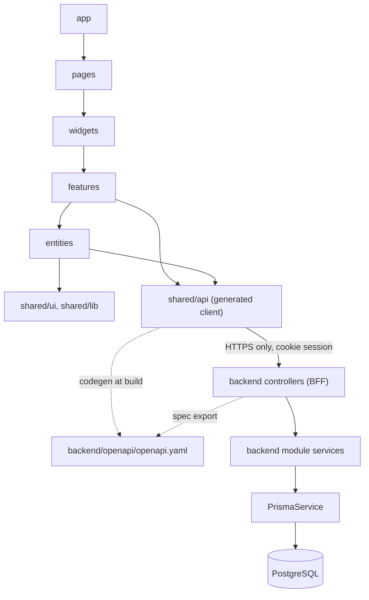
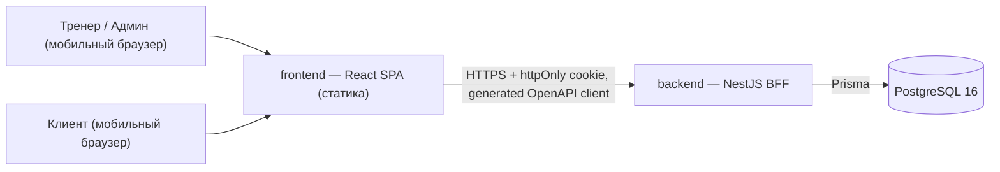
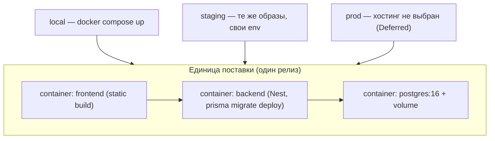
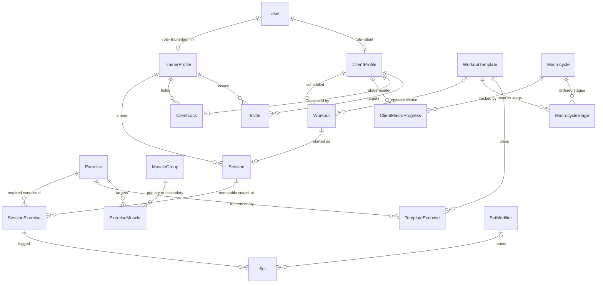

# Architecture Spine — Quest Fitness

Build-substrate для агентной реализации. Решения, без обоснований (обоснования — в `.memlog.md`).

## Design Paradigm

**Modular monolith + BFF.** Один процесс NestJS владеет аутентификацией, доменными командами/запросами и OpenAPI-контрактом для единственного React SPA. Одна база PostgreSQL. Домен — Nest-модули внутри `backend/`, не микросервисы. Frontend — чистый клиент контракта BFF.

| Слой парадигмы | Директория | Содержимое |
| --- | --- | --- |
| Client shell (UI + UX-состояние) | `frontend/src/{app,pages,widgets}` | роутинг, композиция экранов, mobile-first layout |
| Client scenarios | `frontend/src/features` | сценарии (start-session, log-set, copy-invite, acquire-lock) |
| Client domain models (read-only проекции) | `frontend/src/entities` | client, workout, session, exercise, template |
| Generated contract client | `frontend/src/shared/api` | типы + fetch-клиент из OpenAPI (только codegen-вывод) |
| API boundary (BFF) | `backend/src/modules/*/[controller]` | HTTP, DTO, guards, источник OpenAPI |
| Domain services (инварианты) | `backend/src/modules/*/[service]` | lock, статусы, стрик, snapshot, тоннаж |
| Persistence | `backend/prisma` + `PrismaService` | единственный доступ к Postgres |
| Cross-cutting | `backend/src/common` | guards, pipes, error envelope, конфиг |

## Invariants & Rules

### AD-1 — Граница репозитория и BFF `[ADOPTED]`

- **Binds:** все юниты Скелета
- **Prevents:** обращение FE к БД; две формы API; «каша» пакетов без контракта
- **Rule:** Корни репозитория — только `frontend/` и `backend/`. Frontend обращается исключительно к BFF через клиент, сгенерированный из OpenAPI YAML backend-а. Backend — единственный писатель в Postgres (через Prisma). Общего runtime-пакета, импортирующего и UI, и Nest, не существует.

### AD-2 — Владение OpenAPI `[ADOPTED]`

- **Binds:** поверхность API, типы FE
- **Prevents:** выдумывание DTO на FE; два конкурирующих спека; ручная правка сгенерированного файла; разъезд OpenAPI 3.0 vs 3.1
- **Rule:** Канонический файл — `backend/openapi/openapi.yaml` (**коммитится** в git). Pipeline: Nest DTO + `@nestjs/swagger` → `export-openapi.ts` пишет YAML в формате **OpenAPI 3.0.x** (нативный эмит Nest); codegen FE (`openapi-typescript`) читает **только** этот путь. Ручной второй YAML запрещён. Сборка frontend **падает**, если файл отсутствует или codegen не проходит. До полного CI (Deferred с хостингом) гейт — локальный/скрипт `pnpm`/`npm` prebuild.

### AD-3 — Модульный монолит `[ADOPTED]`

- **Binds:** структура backend
- **Prevents:** преждевременные микросервисы и дополнительные хранилища
- **Rule:** Один процесс Nest, один Postgres. Домен = Nest-модули (`auth`, `users`, `invites`, `clients-lock`, `exercises`, `templates`, `macrocycles`, `workouts`, `sessions`, `diary`). Ни Redis, ни Kafka, ни очередей, ни websockets в Скелете. Межмодульное взаимодействие — только через инжекцию сервисов; модуль не читает таблицы чужого домена напрямую.

### AD-4 — Роли и пулы `[ADOPTED]`

- **Binds:** FR-1, FR-2, FR-2a
- **Prevents:** «ответственный тренер», изолированные списки клиентов
- **Rule:** Роли `client` | `trainer` | `admin` (`admin` ⊇ `trainer`). Все клиенты — один пул, все тренеры/админы — один пул. Поля владельца у Client нет. Session хранит `authorTrainerId`. Авторизация — guard по роли + проверка ресурса на BFF; Client читает только собственный кабинет/дневник.

### AD-5 — Аутентификация и инвайт `[ADOPTED]`

- **Binds:** FR-3, FR-3a, FR-5, FR-33
- **Prevents:** JWT в localStorage; SMS OTP; две схемы входа; повторное использование инвайта; разъезд cookie-политики между FE и BFF; разлогин всего зала при рестарте backend
- **Rule:** Серверная сессия + httpOnly cookie. Пароли хешируются argon2id (`argon2` npm, memoryCost≥65536). Инвайт: opaque-токен хранится **в виде хеша**, строка имеет явный `expiresAt` = created + **1 сутки**; погашение — в транзакции БД, помечающей инвайт consumed ровно один раз, иначе ошибка. Поля регистрации: имя, телефон, логин, пароль. Телефон канонизируется в **E.164** при записи и при поиске входа; логин хранится **lowercase**. Уникальность: `(phoneE164)` и `(loginNormalized)` по пользователям. Повторный вход: **логин или телефон** + пароль. Тренер/Админ: логин + пароль. В Скелете есть сброс пароля клиента Админом и перевыпуск инвайта Тренером/Админом. Первый Админ — только из env `SEED_ADMIN_LOGIN` + `SEED_ADMIN_PASSWORD` в `prisma/seed.ts` (дефолтного пароля в репозитории нет).
- **Rule (origin, cookie, CSRF):** Frontend и BFF отдаются **same-site во всех окружениях**: локально — через Vite dev proxy, в staging/prod — через один origin за реверс-прокси. Cookie сессии: `httpOnly; Secure` (вне `local`); `SameSite=Lax; Path=/`. Сгенерированный клиент использует `credentials: 'same-origin'`. Кросс-origin хостинг FE и BFF и `SameSite=None` в Скелете **запрещены** (CORS с `credentials: true` не настраивается). Все мутирующие маршруты проходят через **один глобальный Nest CSRF-guard** (custom-header / double-submit). Сессии хранятся **в таблице Postgres**, не в памяти процесса: рестарт backend не разлогинивает зал и не рвёт активную Сессию.

### AD-6 — Эксклюзивная блокировка Клиента `[ADOPTED]`

- **Binds:** FR-2b, все мутации программы/расписания/сессии клиента
- **Prevents:** двух тренеров на одном клиенте; расщепление lock между Redis и БД; чтение, которое молча захватывает блокировку; вечную блокировку под брошенной Сессией; уход с карточки без освобождения (нарушение FR-2b)
- **Rule (хранение и числа):** Блокировка — строка Postgres с unique по `clientId` (`holderTrainerId`, `lastActivityAt`, опционально `activeSessionId`). FE посылает heartbeat **не реже чем раз в 60 с**, пока открыта карточка/Сессия; idle-TTL — **30 минут** от `lastActivityAt`. Мутации программы клиента, его расписания и сессии/подходов **требуют** удержания блокировки актором.
- **Rule (захват):** Блокировка берётся **только явным** `POST /clients/:clientId/lock` — действие «Взять клиента». `GET`-чтения блокировку **никогда** не захватывают: карточка открывается на чтение всегда, в том числе когда клиент занят другим. Мутирующая команда блокировку не захватывает неявно: без удержания → `LOCK_REQUIRED`, при чужом живом удержании → `409 CLIENT_LOCKED` (`holderTrainerId`, `expiresAt`); UI предлагает «Взять клиента». Захват — **один атомарный оператор**: `INSERT … ON CONFLICT (clientId) DO UPDATE … WHERE holderTrainerId = :actor OR lastActivityAt < now() - interval '30 minutes'`. Ответ несёт серверный `expiresAt` — **единственный** источник отсчёта в UI.
- **Rule (освобождение, FR-2b):** Ровно четыре пути: (1) явный `DELETE` при **уходе Тренера с карточки** (в т.ч. soft-release), (2) терминальное состояние Сессии, (3) истечение TTL, (4) force-unlock («Освободить») держателем или Админом. Если при soft-release есть незавершённая Сессия — в **той же транзакции** Сессия → `abandoned` (AD-15), Тренировка → `pending`, затем лок снимается (уход с карточки **всегда** освобождает Клиента, как требует FR-2b; «продолжить чужую active-сессию» запрещено). Освобождение по `unload` — **best-effort** (`pagehide` + keepalive); гарантия — TTL.
- **Rule (TTL vs активная Сессия):** Пока `activeSessionId` указывает на `active` Сессию **и** держатель остаётся на карточке/экране Сессии, idle-TTL **не** снимает блокировку (FR-2b: Сессия продлевает лок). Подвешивание ограничено: если **60 минут** нет ни записи Подхода, ни heartbeat, BFF сам переводит Сессию в `abandoned` (AD-15) и далее лок истекает обычным TTL — вечная блокировка без Админа невозможна. Force-unlock также → `abandoned`; второй тренер **не** продолжает тот же `sessionId`.

### AD-7 — Общие Шаблоны: LWW + snapshot Сессии `[ADOPTED]`

- **Binds:** FR-8, FR-9, FR-18
- **Prevents:** молчаливую перезапись Шаблона; переписывание истории правкой Шаблона; расхождение snapshot между старт и завершение; молчаливое переуказание этапа при reorder макроцикла; двойной сдвиг указателя двумя модулями
- **Rule:** Шаблоны общие для пула; оптимистичная конкуренция по полю `version`; конфликт → **409** `TEMPLATE_VERSION_CONFLICT` (с `currentVersion`) + предупреждение, повтор после явного перезагруза (last-write-wins). Блокировка AD-6 на Шаблоны **не** распространяется. На **старте Сессии** BFF фиксирует неизменяемый snapshot плана упражнений в Session; подходы привязываются к snapshot. Правки Шаблона никогда не меняют прошлые Сессии.
- **Rule (указатель этапа Макроцикла):** `ClientMacroProgress.currentStageId` — **FK на элемент макроцикла** (`MacrocycleStage`), никогда не целочисленный индекс. Любой reorder или удаление элементов макроцикла обязан в **той же транзакции** явно переуказать или обнулить указатель у всех затронутых клиентов. Указатель сдвигает **ровно одно место** — модуль `workouts` при переходе Тренировки в `attended`, в той же транзакции, и только если Тренировка создана из текущего этапа; плюс явная команда Тренера (override). Модули `sessions` и `macrocycles` указатель **не двигают** никогда.

### AD-8 — Персистентность подходов и таймеры `[ADOPTED]`

- **Binds:** FR-12..FR-18, NFR таймеров (§4.13)
- **Prevents:** подходы только в памяти SPA; таймеры только на setInterval; неоднозначный порядок подходов; дубли строк Set при retry после таймаута; клиентский буфер записи, под который BFF не проектировался
- **Rule:** Каждый подтверждённый Подход немедленно пишется в Postgres. `sequenceIndex` и `supersetGroupId` назначает **сервер** при upsert (клиент не владеет порядком). Чтения сортируют по `sequenceIndex`, не по `createdAt`. Перезагрузка восстанавливает Сессию из БД. Таймеры длительности и отдыха — **только клиентские** абсолютные `endsAt`; тикающее состояние в БД не хранится. Отдых после полного круга суперсета — FE над упорядоченным логом. Подтверждённый Подход в `active` Сессии можно править/удалять держателем лока; после `completed`/`abandoned` — **immutable**.
- **Rule (идемпотентность записи Подхода):** `setId` — UUID, **генерируемый клиентом** и передаваемый в запросе; запись применяется идемпотентным upsert, поэтому повторённый или задублированный запрос физически не может создать вторую строку. Frontend держит **максимум один in-flight Подход** плюс явный повтор («не сохранилось, повторить»). Клиентской очереди, `sessionStorage`-буфера и фонового flush в Скелете **не существует**.

### AD-9 — Объём Скелета и hooks Этапа 2 `[ADOPTED]`

- **Binds:** FR-19a, FR-21..FR-30a
- **Prevents:** раздувание Скелета поведением Этапа 2; глубокий дизайн отложенных домейнов; потерю IA кабинета
- **Rule:** Реализуется только объём PRD §6.1. Аналитика, питание, замеры, ачивки/ранги, каталог и списание абонемента в Скелете **не** реализуются. Допустимы только точки расширения, не меняющие поведение Скелета: пустые Nest-модули и nullable-FK/placeholder-поля в схеме. Хуки списания абонемента остаются no-op до Этапа 2. Статусы Тренировки работают без модуля Абонемента.
- **Rule (IA кабинета Клиента, FR-19a):** Навигация кабинета **зафиксирована как 6 вкладок**: Тренировки | Аналитика | Питание | Замеры | Ачивки | Абонемент. В Скелете рабочая — **Тренировки** (+ вход в историю Сессии); остальные пять — навигационные заготовки («Скоро» / stub), без бизнес-логики Этапа 2.

### AD-10 — Направление зависимостей `[ADOPTED]`

- **Binds:** размещение всего кода
- **Prevents:** циклы FE↔BE; доменные правила в React; обход генерируемого клиента
- **Rule:** Зависимости идут только вниз по схеме. Frontend общается с BFF **только по HTTP** через сгенерированный клиент. Доменные инварианты (блокировка, статусы, стрик, snapshot, персистентность подходов, тоннаж) считаются на **backend**; frontend может зеркалить UX-состояние, но не является источником истины.



### AD-11 — Платформа и целевой клиент `[ADOPTED]`

- **Binds:** FR-31, FR-32, SM-3, SM-C1, все UI-юниты
- **Prevents:** нативные приложения; multi-tenant/SaaS-абстракции; desktop-first; шумный UI, тормозящий Сессию
- **Rule:** Единственный клиент — веб-приложение SPA, React + TypeScript, mobile-first: крупные тач-зоны, **минимум шагов**, сценарии Скелета проходимы одной рукой. Продукт — внутренний инструмент **одного** зала: без tenant-идентификатора, без регистрации залов, без публичного self-serve. Визуальный язык «Гильдия» binding: тёплый светлый фон, уголь, красный акцент `#C33F46` (из UX), без декора, мешающего потоку в зале; источник токенов — `design-brief-guild.md` + `docs/design-refs/`. Экран live-Сессии — кратчайший путь к первому залогированному Подходу (SM-3 / SM-C1): не добавлять промежуточные экраны и промо Этапа 2 на путь Сессии.

### AD-12 — Runtime baseline `[ADOPTED]`

- **Binds:** backend, персистентность
- **Prevents:** свободный выбор стека в story; несовместимые версии; второй ORM/драйвер
- **Rule:** Backend = NestJS 12 + Prisma (линия 7) + PostgreSQL 16 на Node 22 LTS (≥22.12). Prisma — единственный способ доступа к БД; сырой SQL допустим только через Prisma внутри доменного сервиса. Схема БД меняется только миграциями Prisma. Версии пинуются точно (см. Stack); `latest` не используется.

### AD-13 — Operational envelope `[ADOPTED]`

- **Binds:** сборка, запуск, окружения
- **Prevents:** разъезд версий FE/BE в рантайме; ручные правки схемы на сервере; изобретение облачного провайдера
- **Rule:** Одна единица поставки: стек из трёх контейнеров (`frontend` — статика, `backend` — Nest, `postgres`), релиз версионируется и деплоится целиком. Локально и в dev — Docker Compose (`docker-compose.yml` в корне). Окружения: `local`, `staging`, `prod`; отличаются только переменными окружения и секретами, не кодом. Миграции применяются `prisma migrate deploy` на деплое, не вручную. Контейнер `frontend` — **единственный публичный origin**: он отдаёт статику и проксирует `/api` на `backend` (контейнер `backend` наружу не публикуется), чем и обеспечивается same-site из AD-5; локально ту же роль играет Vite dev proxy. **Хостинг prod не выбран** — см. Deferred; провайдер не придумывать.

### AD-14 — Online-required логирование `[ADOPTED]`

- **Binds:** FR-13, FR-18
- **Prevents:** второй стек синхронизации; выдуманный offline sync-движок; расхождение со «самоотправкой» из UX-текста
- **Rule:** Скелет требует сети для записи подходов. Сбой сети → явная ошибка + retry в UI (индикатор: `сохранено` · `сохраняется` · `не сохранилось, повторить`). Offline-очереди, локальной БД на клиенте и merge-логики в Скелете нет. Идемпотентность записи — по AD-8 (клиентский `setId` + upsert).
- **Rule (приоритет артефактов):** Норматив — этот spine (AD-8 + AD-14). `EXPERIENCE.md` согласован (2026-09-29): offline-очередь убрана; индикатор `сохранено` · `сохраняется` · `не сохранилось, повторить`. При будущем расхождении побеждает spine.

### AD-15 — Терминальные состояния Сессии `[ADOPTED]`

- **Binds:** FR-11, FR-13, FR-17, FR-18, FR-20, FR-30a (hook)
- **Prevents:** два противоположных исхода прерванной Сессии; «abandoned» без легального статуса Тренировки; молчаливое исчезновение подходов прерванной Сессии из Дневника
- **Rule:** `Session.status` ∈ `active` | `completed` | `abandoned`; терминальных состояний ровно два. `completed` — Тренер подтвердил «Завершить» → Тренировка переходит в `attended`. `abandoned` — force-unlock либо idle-протухание Сессии (60 минут без записи Подхода и без heartbeat, AD-6) → Тренировка **возвращается в `pending`**. Прерванная Сессия и её Подходы остаются **читаемыми** в Дневнике с пометкой «не завершена» (не удаляются — FR-2a требует неизменяемый журнал). Прерванная Сессия **никогда** не учитывается в Стрике, **никогда** не сдвигает указатель этапа Макроцикла и **никогда** не триггерит списание абонемента Этапа 2. Переход `abandoned → completed` невозможен: второй тренер начинает новую Сессию.

### AD-16 — Стрик — чистое производное значение `[ADOPTED]`

- **Binds:** FR-20, FR-19a
- **Prevents:** дрейфующий счётчик-колонку; два независимых фолда (BE + FE); зависимость ответа от порядка правок истории
- **Rule:** Стрик считается **on demand** модулем `workouts` из Тренировок клиента, упорядоченных по `scheduledAt ASC, id ASC`, фолдом статусов по FR-20 (`pending` прозрачен, `skipped`/`cancelled` → 0, разгон 0 → 2 → +1; перенос не сбрасывает). Колонки `streakCount`, счётчика и кеша **не существует**; иной backend-модуль фолд не переизобретает; frontend отображает пришедшее с сервера значение дословно и **не пересчитывает** его.

### AD-17 — Таймзона зала как календарный авторитет `[ADOPTED]`

- **Binds:** FR-5, FR-11, FR-19, FR-20
- **Prevents:** «текущий месяц» и «просрочена», зависящие от часового пояса устройства; разные ответы на разных экранах
- **Rule:** Одна таймзона зала — `Europe/Moscow` по умолчанию, переопределяется env `GYM_TIMEZONE` — единственный календарный авторитет. Мгновения хранятся и передаются как UTC ISO-8601, но каждое календарное производное значение — количество Тренировок в текущем месяце, флаг «просрочена», группировка по дням, границы дней Стрика, отображение срока жизни инвайта — вычисляется **на BFF** в этой таймзоне и отдаётся явным полем ответа. Frontend **не выводит** ни дневную корзину, ни флаг «просрочена» из таймзоны браузера.

### AD-18 — TDD и запрет додумывания `[ADOPTED]`

- **Binds:** все юниты реализации (PRD §10)
- **Prevents:** код без теста; выдуманные фичи вне spine/AC
- **Rule:** Реализация агентами — **тест → red → green → refactor**. Backend: Vitest рядом с модулем (`*.spec.ts`); критичные инварианты (lock acquire, invite consume, set upsert, streak fold, session abandon) — обязательные тесты. Frontend: Vitest + Testing Library для features с мутациями. Нет в spine / AC / PRD → **спросить**, не изобретать. Производные поля не хранятся, если их можно вычислить.

### AD-19 — Soft-delete каталога и деактивация людей `[ADOPTED]`

- **Binds:** FR-2, FR-6, FR-16, FR-18
- **Prevents:** cascade-удаление истории Дневника; блокировку Тренера без способа выйти; «дырявые» FK
- **Rule:** Упражнения и Модификаторы **не hard-delete**, если на них есть ссылки из `SessionExercise`/`Set` или шаблонов: только `archivedAt` (soft-delete); FK на историю — `ON DELETE RESTRICT`. Новые шаблоны/сессии не предлагают archived. Клиент и Тренер: `deactivatedAt` вместо удаления; деактивированный Тренер — сессии auth инвалидируются, удерживаемый `ClientLock` снимается (Сессия → `abandoned` при необходимости). История Сессий с `authorTrainerId` сохраняется.

### AD-20 — Границы модулей при смене статуса `[ADOPTED]`

- **Binds:** FR-11..FR-18, FR-20
- **Prevents:** два писателя статуса Workout; diary, читающий чужие таблицы в обход сервисов
- **Rule:** Переходы статуса Workout (`pending`↔`attended`/`skipped`/`cancelled`, возврат в `pending` при `abandoned`) выполняет **только** модуль `workouts` (в т.ч. по вызову из `sessions` через сервис `workouts`, не прямым SQL). `diary` — query-модуль: читает через Prisma только разрешённые read-модели/views или сервисы `sessions`/`workouts`, не мутирует. Идемпотентность команд статуса: клиентский `Idempotency-Key` на мутирующих POST смены статуса (хранит ответ 24ч) — кроме Set-upsert, где ключ = `setId`.

## Consistency Conventions

| Concern | Convention |
| --- | --- |
| Naming (код) | Идентификаторы английские; **глоссарий PRD обязателен**. Маппинг: Клиент→`Client`/`ClientProfile`, Тренер→`Trainer`/`TrainerProfile`, Тренировка→`Workout`, Сессия→`Session`, Шаблон→`WorkoutTemplate`, Макроцикл→`Macrocycle`/`MacrocycleStage`, Подход→`Set`, Модификатор→`SetModifier`, Ссылка-приглашение→`Invite`, Блокировка→`ClientLock`, Дневник→`Diary` (read-model), `ClientMacroProgress`, `MuscleGroup`/`ExerciseMuscle`. Новые имена вне списка — только через обновление spine |
| Файлы | FE: kebab-case директории FSD-слоёв, PascalCase React-компоненты. BE: `<domain>.controller.ts` / `.service.ts` / `.module.ts`, DTO — `<action>.dto.ts` |
| IDs | UUID v4 строкой в API и в БД (`@db.Uuid`) |
| Даты/время | ISO-8601 UTC в API и в БД; календарные производные (месяц, «просрочена», дневные корзины, срок инвайта) считает BFF в таймзоне зала и отдаёт явным полем (AD-17); TZ браузера — только форматирование, не семантика |
| Списки | Пагинация `page` + `pageSize` (max 100); единая форма ответа `{ items, total, page, pageSize }` для всех коллекций в OpenAPI |
| Error envelope | Любой не-2xx ответ BFF — одна схема `{ error: { code, message, details? } }`. `code` берётся из единственного **исчерпывающего** enum `ErrorCode` в `backend/src/common/errors` и публикуется в OpenAPI. Минимальный состав: `VALIDATION_FAILED`, `UNAUTHENTICATED`, `FORBIDDEN_ROLE`, `NOT_FOUND`, `CLIENT_LOCKED` (`details`: `holderTrainerId`, `expiresAt`), `LOCK_REQUIRED`, `TEMPLATE_VERSION_CONFLICT` (`details`: `currentVersion`), `INVITE_EXPIRED`, `INVITE_ALREADY_CONSUMED`, `SESSION_ABANDONED`, `SESSION_ALREADY_ACTIVE`, `WORKOUT_STATUS_CONFLICT`, `RATE_LIMITED`, `INTERNAL_ERROR`. Frontend ветвится **только по `code`**, никогда по HTTP-статусу или тексту сообщения. HTTP-маппинг: `400` валидация, `401` нет сессии, `403` роль/ресурс, `404`, `409` конфликты блокировки/версии/статуса |
| Auth cookie | Одна httpOnly cookie `qf_session`; `Secure` вне `local`, `SameSite=Lax`, `Path=/`, срок — серверная сессия в таблице Postgres; сгенерированный клиент — `credentials: 'same-origin'`; один глобальный CSRF-guard на все мутирующие маршруты (AD-5) |
| Authz | Nest guard по роли из сессии + проверка ресурса; Client не имеет доступа к чужим данным и к командам Тренера |
| Мутации | Только команды BFF; FE не имеет доступа к таблицам; мутации клиента требуют lock (AD-6) |
| Стрик | Производное значение, считается на сервере в `workouts` по FR-20 без колонки и кеша, порядок `scheduledAt ASC, id ASC` (AD-16) |
| Статусы Workout | `pending` / `attended` / `skipped` / `cancelled`; перенос меняет дату/время и оставляет `pending`; прерванная Сессия возвращает Тренировку в `pending` (AD-15) |
| Статусы Session | `active` / `completed` / `abandoned`; терминальные — `completed` и `abandoned` (AD-15) |
| Прогресс Макроцикла | Указатель этапа на клиента — `currentStageId` (FK на `MacrocycleStage`, не индекс); в расписание ставится одна Тренировка; `skipped`/`cancelled`/перенос/`abandoned` указатель не двигают; сдвигает только `workouts` при переходе в `attended` либо явная команда Тренера (AD-7) |
| Модификаторы подхода | Каталог зала, общий для пула: пресеты + кастом (название + RGB) |
| Логин/пароль правила | Валидация зеркалится на BFF из UX-артефакта (те же длины/regex); пока UX не зафиксировал — константы в одном модуле `auth`, не разбросаны |
| Тоннаж / рост | BFF по обязательному `SessionExercise.exerciseId` только для `completed` Сессий (FR-17) |
| Тесты | TDD (AD-18); доменные инварианты — обязательные тесты |
| Кабинет noindex | HTML кабинета: `noindex,nofollow` (FR-33) |
| Логи | Структурированные логи на BFF; без ПДн в сообщениях и без ПДн в консоли браузера |
| Конфиг | Переменные окружения backend: `DATABASE_URL`, `SESSION_SECRET`, `GYM_TIMEZONE` (default `Europe/Moscow`), `NODE_ENV`; `CORS_ORIGIN` не нужен — деплой same-site (AD-5); секретов в репозитории нет |

## Stack

| Name | Version |
| --- | --- |
| Node.js | 22 LTS (`>=22.12 <23`) |
| NestJS (`@nestjs/core`) | 12.1.1 |
| Prisma CLI + `@prisma/client` | 7.10.0 (точный пин; `latest` отдаёт 8 RC) |
| PostgreSQL | 16 |
| React | 19.3.0 |
| Vite | 8.3.1 |
| TypeScript | 5.9.x (не переходить на TS 7 без проверки peer у codegen) |
| OpenAPI | **3.0.x** YAML в `backend/openapi/openapi.yaml` (эмит Nest swagger; коммитится) |
| `@nestjs/swagger` | 11.x (peer Nest 12; пин при scaffold) |
| openapi-typescript | 7.13.0 |
| openapi-fetch | 0.17.0 |
| Vitest | 3.x (пин при scaffold; не 4+ без проверки Nest) |
| argon2 (npm) | latest 0.41.x line; параметры argon2id |
| Хеш пароля | argon2id |
| Локальная оркестрация | Docker Compose (`frontend`, `backend`, `postgres:16`) |

## Structural Seed

### Система



### Развёртывание и окружения



### Доменные сущности (глоссарий → персистентность)



- `WorkoutTemplate` несёт `version` (AD-7) + поля FR-8: название, тип, описание, длительность, продолжительность в микроциклах.
- `Macrocycle` несёт периодичность / порядок этапов (`MacrocycleStage`).
- `Workout` несёт статус (`pending`/`attended`/`skipped`/`cancelled`) и дату/время визита.
- `Session` несёт `status` (`active`/`completed`/`abandoned`, AD-15); `abandoned` читается в Дневнике как незавершённая.
- `SessionExercise.exerciseId` — **обязательный** FK; рост тоннажа FR-17 — по этому id vs последнее `completed` выполнение того же упражнения Клиентом.
- `ClientMacroProgress` несёт `currentStageId` — FK на `MacrocycleStage`, не целочисленный индекс (AD-7).
- `Set.id` — UUID, сгенерированный клиентом; запись идемпотентна (AD-8).
- Серверные сессии аутентификации живут отдельной таблицей в Postgres (AD-5).
- **Дневник** — read-model над `Session` + `SessionExercise` + `Set`; **Стрик**/тоннаж/рост — вычисляемые (AD-16).
- Сущности Этапа 2 в ядро ERD не входят — см. Deferred.

### Дерево исходников

```text
quest-fitness/
  frontend/
    src/
      app/                      # провайдеры, роутер, тема Гильдия, глобальные стили
      pages/                    # экраны: client-pool, client-card, session, diary, cabinet (6 tabs IA)
      widgets/                  # session-log, workout-list, streak-card, month-calendar, sync-indicator
      features/                 # acquire-lock, start-session, log-set, copy-invite
      entities/                 # client, trainer, workout, session, exercise, template
      shared/
        api/                    # ТОЛЬКО сгенерированные типы + openapi-fetch клиент
        ui/                     # примитивы, токены Гильдии (палитра из design-brief)
        lib/                    # таймеры на endsAt, форматтеры
      **/*.spec.ts              # Vitest + Testing Library (AD-18)
    index.html
    package.json                # скрипт codegen читает ../backend/openapi/openapi.yaml
  backend/
    openapi/
      openapi.yaml              # канонический контракт (экспорт из Nest, FE читает его)
    src/
      main.ts
      app.module.ts
      common/                   # guards (role, CSRF), pipes, конфиг, пагинация, TZ зала
        errors/                 # единственный enum ErrorCode + error envelope
      modules/
        auth/                   # серверная сессия в Postgres, cookie, argon2id, вход логин|телефон
        users/                  # пул тренеров, роли, сброс пароля админом
        invites/                # выдача, хеш токена, expiresAt, однократное погашение
        clients-lock/           # ClientLock: acquire / heartbeat / release / force-unlock
        exercises/              # каталог + мышечные группы
        templates/              # WorkoutTemplate + version
        macrocycles/            # Macrocycle, стадии, ClientMacroProgress
        workouts/               # расписание, статусы, перенос, стрик
        sessions/               # старт, snapshot, подходы, модификаторы, итог
        diary/                  # read-model истории для Клиента и Тренера
      scripts/
        export-openapi.ts       # пишет openapi/openapi.yaml на build/CI
    prisma/
      schema.prisma
      migrations/
      seed.ts                   # мышечные группы, пресеты модификаторов, первый Админ
    package.json
  docker-compose.yml            # frontend, backend, postgres:16
  docs/
  _bmad-output/
```

## Capability → Architecture Map

| Capability / FR | Lives in | Governed by |
| --- | --- | --- |
| FR-1 Роли | `users`, `common/guards` | AD-4 |
| FR-2 Управление пулом тренеров | `users` | AD-4 |
| FR-2a Общий пул клиентов | `users`, `diary` | AD-4 |
| FR-2b Эксклюзивная работа с Клиентом | `clients-lock` + `features/acquire-lock` | AD-6 |
| FR-3 / FR-3a Аутентификация | `auth` (+ таблица сессий, CSRF-guard в `common`) | AD-5 |
| FR-4 Создание Клиента | `users` | AD-4 |
| FR-5 Ссылка-приглашение (TTL 1 д.) | `invites` + `features/copy-invite` | AD-5, AD-17 (отображение срока) |
| FR-6 CRUD упражнений | `exercises` | AD-3, AD-12 |
| FR-7 Мышечные группы | `exercises` (`ExerciseMuscle`) | ERD, AD-12 |
| FR-8 Шаблон тренировки | `templates` | AD-7 |
| FR-9 Макроцикл и поэтапный прогресс | `macrocycles` (`ClientMacroProgress`), сдвиг указателя — только `workouts` | AD-7, AD-15 |
| FR-10 Назначение Тренировки | `workouts` | AD-6, conventions |
| FR-11 Ожидание / Начать / Пропустить / Отменить / Перенести | `workouts` | AD-6, AD-15, AD-17, conventions (статусы) |
| FR-12 Старт Сессии + таймер длительности | `sessions` + `shared/lib` таймеры | AD-7 (snapshot), AD-8, AD-15 |
| FR-13 Лог подхода | `sessions` | AD-8, AD-14 |
| FR-14 Отдых | `frontend/features` (endsAt) | AD-8 |
| FR-15 Суперсеты | `sessions` (`supersetGroupId`) + FE | AD-8 |
| FR-16 Модификаторы, включая кастом | `sessions` (`SetModifier`) | conventions (каталог зала) |
| FR-17 Итог Сессии, рост тоннажа по упражнению | `sessions` (по обязательному `exerciseId`) | AD-10, AD-15, ERD |
| FR-18 История в Дневнике | `diary` | AD-8, AD-4, AD-15 |
| FR-19 / FR-19a Кабинет (6 вкладок IA) | `frontend/pages/cabinet` + `workouts`/`diary` | AD-4, AD-9, AD-11, AD-17 |
| FR-20 Стрик тренировок | `workouts` (derived) | AD-16 |
| FR-31 / FR-32 UI + Гильдия | `frontend` + design-brief | AD-11 |
| FR-33 ПДн (минимум) | `common/guards`, `auth`, noindex | AD-4, AD-5; 152-ФЗ — Deferred |
| TDD / агентная дисциплина | `*.spec.ts` FE/BE | AD-18 |
| Контракт и codegen | `backend/openapi` → `frontend/src/shared/api` | AD-1, AD-2 |
| Этап 2 (FR-21..30a) | только заготовки модулей + stub-вкладки | AD-9 |

## Deferred

| Item | Почему может ждать / условие возврата |
| --- | --- |
| Хостинг prod (VPS / PaaS / on-prem в зале), TLS, домен | Пользователь выбор не сделал. Скелет работает на Docker Compose. Вернуться перед первым прод-деплоем; провайдер не выбирать за пользователя |
| Бэкапы, мониторинг, алерты, CI/CD-пайплайн | Зависят от выбора хостинга (см. выше) |
| Детали 152-ФЗ: согласия, сроки хранения, политика, экспорт/удаление ПДн | PRD OQ-1. Для Скелета достаточно ролевой изоляции и отсутствия публичной индексации. Вернуться при выходе на реальных клиентов |
| Точные правила сложности пароля и формата логина | Владеет UX; BFF зеркалит. Вернуться после UX-артефакта |
| Offline-очередь записи подходов | Явно вне Скелета (AD-14). Вернуться, если в зале подтвердится систематический сбой сети |
| Правка `EXPERIENCE.md` под AD-8/AD-14 (убрать «уйдут сами» / очередь) | **Done** 2026-09-29 — UX согласован; story FR-13 может резаться |
| Архивация Клиента / отключение Тренера | PRD OQ-3. До решения — без hard-delete (история Сессий сохраняется). Вернуться перед продом |
| Сброс пароля Админом / перевыпуск инвайта | В Скелете по AD-5 из PRD `[ASSUMPTION]`; при сужении объёма — в Deferred |
| Модули Этапа 2: аналитика (FR-21..23), питание (FR-24..26), замеры (FR-27), ачивки и ранги (FR-28..29a), каталог и экземпляры абонемента + списание (FR-30, FR-30a) | AD-9. Допустимы пустые Nest-модули и nullable-FK как точки расширения; проектировать при старте Этапа 2 |
| Сид тарифов «Путеводитель» в БД | Возможен только после CRUD планов (Этап 2); константами в код не попадает |
| Redis, очереди задач, websockets для live-просмотра | Один зал; cookie + REST + heartbeat достаточно. Вернуться при появлении требования realtime |
| Prisma 8 | `latest` в npm уже отдаёт 8 RC. Остаёмся на точном `7.10.0`; вернуться после GA Prisma 8 |
| Node 24 Active LTS | Скелет на Node 22 (Maintenance LTS, EOL 2027-04). Вернуться перед прод-деплоем или до EOL |
| Мульти-зал / tenancy | Продуктовый non-goal (AD-11) |

## Out of Scope (Скелет)

- SaaS для нескольких залов, маркетплейс тренеров, публичная регистрация.
- Платежи, онлайн-оплата, расчёт ЗП и выручки, финансовые отчёты.
- Самостоятельная запись Клиента на слоты (запись в зале — процесс вне продукта).
- База продуктов / штрихкоды для питания.
- Обязательный realtime-просмотр Сессии Клиентом; чат и комментарии; push-уведомления (в т.ч. при Переносе).
- Модель «ответственный тренер»; одновременное редактирование одного Клиента двумя Тренерами.
- Нативные iOS/Android приложения.
- Поведение Этапа 2 (FR-21..30a) — только заготовки по AD-9.
- Хардкод тарифов, ачивок и рангов в коде.

## Open Questions

1. Хостинг и способ деплоя prod (VPS vs PaaS vs машина в зале) — до первого прод-релиза.
2. Числовые правила валидации логина и пароля — ждём UX; до тех пор константы в `auth`.
3. Нужна ли `staging` фактически — вместе с хостингом.
4. ~~Поправить `EXPERIENCE.md`: offline-очередь / индикатор сохранения (AD-8/AD-14)~~ **Done** 2026-09-29. Остаётся: UX-копирайт для «Взять клиента», незавершённой Сессии — если ещё открыто.
5. Точные правила архивации Клиента и отключения Тренера (Deferred до UX/продукта).
